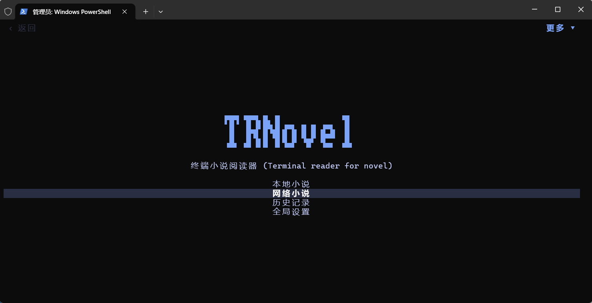
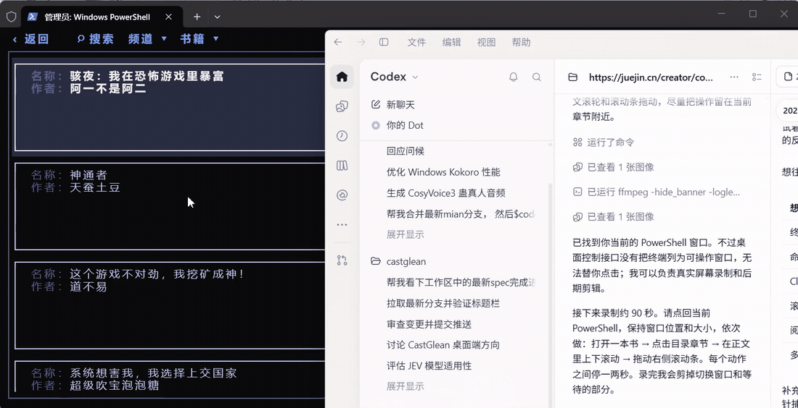
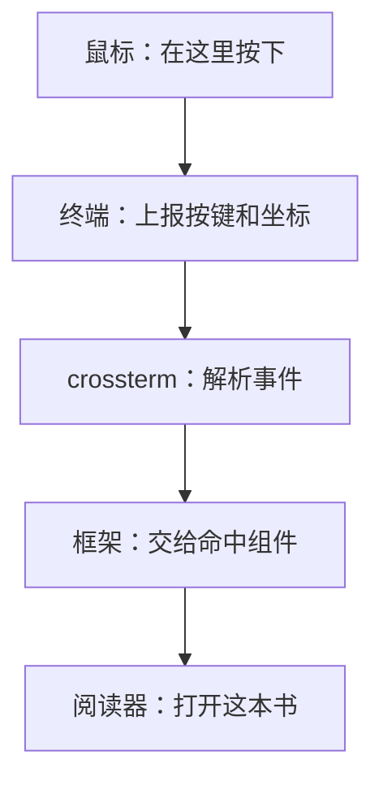
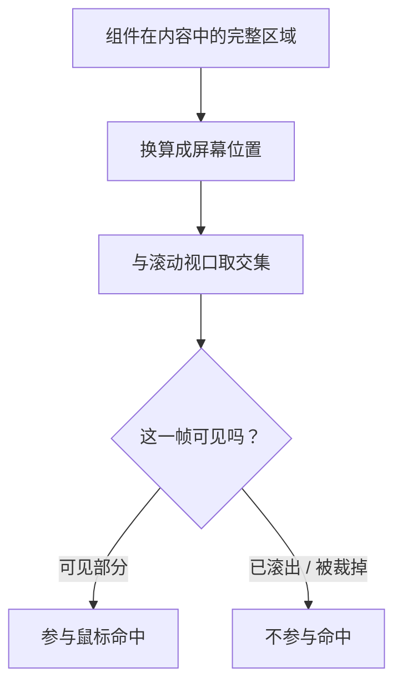
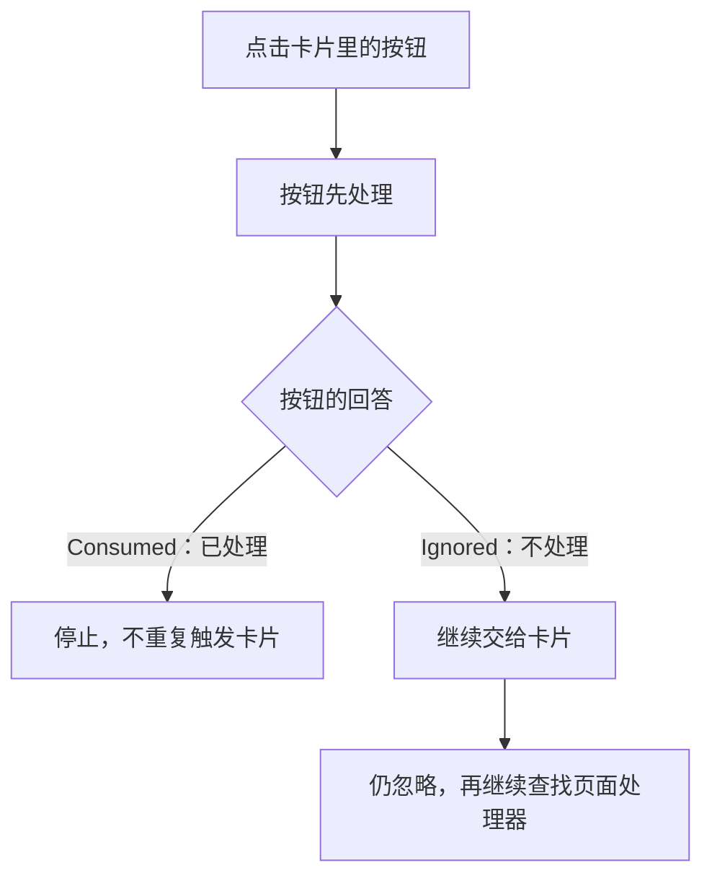
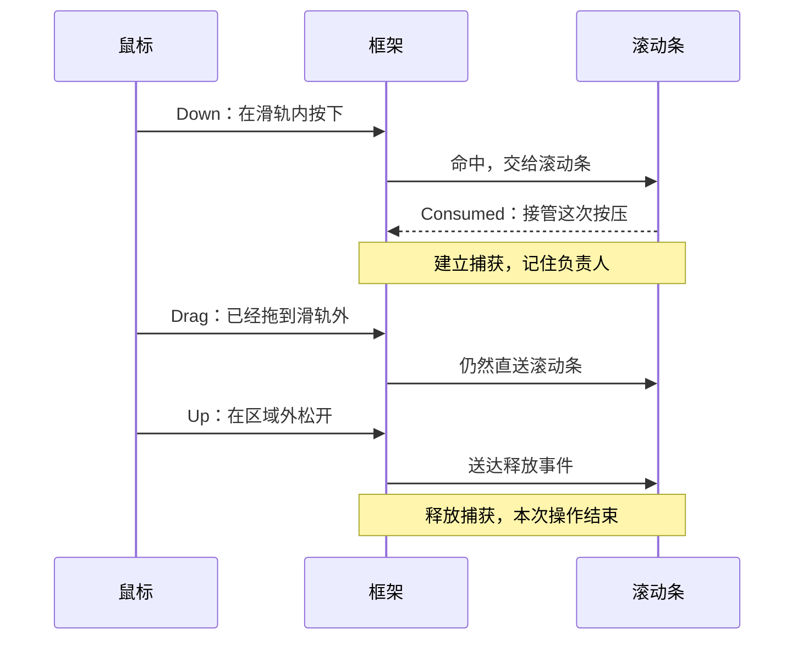

# 谁说终端只能敲键盘？我用 Rust 给小说阅读器加上了鼠标

在终端里看小说，用滚轮翻正文，点目录跳章节，再拖一下滚动条调整阅读位置。

这些操作，现在都能在我写的 Rust 小说阅读器 **TRNovel** 里完成。



*图 1：PowerShell 中的 TRNovel 首页，可进入本地小说、网络小说、历史记录和全局设置。*

不过，“支持鼠标”这四个字，藏的问题比界面上看起来多。

**弹窗里的按钮明明画出来了，为什么就是点不到？**

**滚轮只是多滑了一下，为什么跳到了下一章？**

**拖滚动条时，鼠标离开了滑轨，拖动就该结束吗？**

这些问题都指向同一件事：收到鼠标坐标，只是起点。还得知道它点中了谁、谁先处理、后续事件交给谁。

我把通用能力做进了自己维护的 **ratatui-kit**，再让 TRNovel 接入。先看看阅读器中的实际操作：



*图 2：同一次 PowerShell 屏幕录制，鼠标由我实际操作；片段展示网络小说打开、目录区域操作和正文位置变化。保留了终端标题栏和真实鼠标指针，未使用模拟界面。*

接下来跟着一次点击走一遍。不需要先熟悉整个框架，我们从“点一本书”开始。

## 1. 点一下鼠标，程序收到的竟然是一串字符

假设你准备打开书架上的一本书，点了一下鼠标。

程序收到的不是“打开这本书”，甚至不是“点了这个列表”。它收到的原始输入，可以是这样一串东西：

```text
\x1b[<0;6;5M
```

先别被它劝退。这里包含的信息很简单：**哪个按键、哪一列、哪一行，以及发生了什么动作。**

在这个例子里，它表示左键在协议坐标第 6 列、第 5 行按下。crossterm 解析后，会得到应用能使用的鼠标事件，坐标也转换成从 0 开始的 `(5, 4)`。



*图 3：终端负责上报，crossterm 负责解析，框架负责找到组件，业务代码负责执行动作。*

这里还有个前提：**应用得先告诉终端，我需要鼠标事件。**

否则，拖选文字、滚轮回看输出等行为通常由终端自己处理，应用不一定能收到对应输入。

在 ratatui-kit 中，入口显式开启：

```rust
// 应用入口片段
// 使用 ratatui_kit::prelude::*，App 为应用根组件
element!(App)
    .fullscreen_with(RunOptions { mouse: true })
    .await?;
```

底层负责开启上报，并在退出时关闭捕获、恢复终端行为。组件只需要处理解析好的事件。

到这里，程序知道“有人在 `(5, 4)` 按下了左键”。但书架上可能有十几本书，它怎么知道你点的是哪一本？

## 2. 给组件留一张“位置便签”

先把终端想成一张方格纸。

每个组件占据一块区域：列表在左边，正文在右边，按钮可能只占其中一小块。鼠标给出一个格子坐标，框架就检查：**这个点落在哪些组件的可见区域里？**

这个过程叫命中检测，名字有点技术味，做的事其实就是“点名”。

但组件的位置不是固定的。终端缩小了，布局会变；正文滚动了，内容的位置也会变。所以不能在创建组件时算一次坐标，就一直用下去。

我的做法是：**每次绘制时，给组件更新一张“位置便签”。**

| 便签记什么 | 解决什么问题 |
| --- | --- |
| 实际可见的屏幕区域 | 点击是不是落在这里？ |
| 坐标转换 | 内容滚动以后，屏幕位置在哪里？ |
| 绘制帧号 | 这份位置记录还有效吗？ |
| 绘制顺序 | 重叠时，谁画在上面？ |

源码里这份记录叫 `Stamp`。先记住它的用途就够了，不必一口气读完所有字段。

### 为什么要强调“可见区域”？

想象目录有 100 章，窗口只能显示 20 章。

第 80 章仍然在内容里，但它现在不在屏幕上。它当然不能因为内部坐标碰巧对上，就突然响应一次点击。

所以，框架需要把内容坐标换算到屏幕坐标，再与滚动容器的可见范围取交集。嵌套容器也要逐层转换和裁剪。



*图 4：有内容不等于能点击。只有这一帧实际显示出来的部分，才参与命中。*

帧号则像便签上的日期：组件这一帧没有画出来，就不能继续拿旧位置接收点击。它解决的是“按钮已经消失，那块空气却还能点”的问题。

**画在哪里、能点哪里，必须使用同一套几何信息。**

不过，即使区域都算对了，点击仍然可能失效。因为同一个位置，往往不只命中一个组件。

## 3. 点了按钮，别让它的父组件抢答

一个按钮放在卡片里，卡片又放在页面里。

当你点按钮，这个坐标同时位于按钮、卡片和页面内部。三个处理器都可能符合命中条件。

谁先处理？

如果按注册顺序来，父组件通常先于子组件注册。父组件一旦说“我处理完了”，按钮就没有机会响应。

我利用了框架已有的绘制顺序：父组件先登记绘制信息，子组件随后绘制。**在同一输入层、同一优先级下，让后绘制的组件先处理鼠标。**

每个处理器只需要回答两种结果：

```rust
EventResult::Consumed // 我接下了，停止继续投递
EventResult::Ignored  // 我不处理，继续往后找
```



*图 5：这张图展示父子嵌套的简单情况，前提是同层、同优先级。*

这样，点按钮就先交给按钮；按钮处理并消费后，后面的组件不会再执行一次动作。

如果你熟悉前端，会觉得它有点像事件冒泡。但这里没有照搬完整 DOM 模型：框架按排序后的命中处理器继续投递，重叠的兄弟组件也可能参与。

### 那个“画得出来、点不到”的按钮，怎么回事？

问题出在**优先级**。

框架的层内鼠标顺序是：先看输入层，再看处理器优先级，然后才比较绘制顺序，最后用注册顺序兜底。

之前有个弹窗父级的键盘处理器用了 High 优先级。它处理完键盘分支后，把其他事件也一律返回 `Consumed`。

于是鼠标到来时：父处理器先执行，吞掉事件，子按钮连回调都没机会运行。

修复很小：**键盘处理器只消费自己认识的按键，其他事件返回 `Ignored`。**

这也是写组件事件时很实用的一条规则：只接自己负责的事。兜底吞掉所有输入，看着省心，组合起来就容易出问题。

## 4. 鼠标拖出了滑轨，为什么还得归滚动条管？

现在试试拖动滚动条。

按住，向下拖，手稍微偏了一点，指针离开了细窄的滑轨。

如果框架仍然只看“鼠标现在位于哪个矩形”，滚动条就收不到后续事件了。更麻烦的是：最后那次松开也可能丢失，组件还以为你一直按着。

这里需要分清两个问题：

- **开始时点中了谁？** 靠命中检测回答。
- **这次拖动由谁负责到底？** 靠指针捕获回答。

可以把它理解成：按下时确定负责人，后续移动和松开都继续找这个负责人，直到这次操作结束。



*图 6：指针捕获改变的是事件投递目标，不是把物理鼠标限制在滑轨里。*

在 ratatui-kit 中，命中型指针处理器消费某个按键的 Down，就会建立隐式捕获。同一按键后续的 Drag、Up 会直接送回它，Up 后释放捕获。

这里还得给负责人一个稳定身份。处理器表每帧都会重建，用数组下标记录它，下一帧可能就指错人了。因此框架使用跨帧稳定的 `PointerToken`。

组件卸载、当前帧未绘制，或者所在输入层不再活跃时，捕获也会失效，避免把事件送给已经离场的组件。

### 顺便回答：按下就算点击吗？

不一定。

`use_click` 会等到 Down 和 Up 配对，并确认释放时仍位于组件可命中区域，才生成 Click。按下后拖出区域再松开，就不会生成这次点击。

这是 `use_click` 的语义；内置 `Button` 的按压回调则在左键 Down 时触发。选择 API 时，要看你需要“按下立即响应”，还是“松开确认”。

## 5. 回到阅读器：同样是向下，滚轮和键盘不能照抄

框架已经知道该把事件交给谁。接下来，TRNovel 要把它变成符合阅读习惯的动作。

这里最有意思的，反而不是复杂算法，而是几个很小的交互决定。

### 点列表：先找条目，再复用 Enter 的动作

书架条目可能有多行：书名一行，其他信息又占几行。滚动后，最上面那项还可能只露出一半。

因此，不能直接把“鼠标位于第几行”当成“选中了第几项”。

TRNovel 使用底层列表状态的 `hit_test`，根据实际渲染记录找到条目，再走与 Enter 相同的业务回调。

**鼠标负责定位，业务动作复用。** 这样不用维护两套“打开这本书”的逻辑。

### 滚正文：到章末就停，不替读者决定翻章

键盘有明确的一次按压。滚轮不同，一次滑动往往会产生连续事件。

如果把滚轮直接接到“到章末后再操作一次确认翻章”的逻辑上，同一次滑动就可能先触发确认提示，紧接着又完成确认。

用户只是想往下看一点，章节却跳走了。

所以正文滚轮只负责章内滚动：

| 用户操作 | 阅读器行为 |
| --- | --- |
| 向上滚 | 上移，最多到章首 |
| 向下滚 | 下移，最多到本章贴底位置 |
| 已到章末，继续滚 | 留在当前章 |
| 听书时手动滚动 | 暂停正文自动跟随，允许回看 |

边界计算只有几行。下面是源码中的核心片段，`end_scroll` 表示本章正文的贴底位置：

```rust
let next = if matches!(ev.kind, PointerKind::ScrollUp) {
    line.saturating_sub(WHEEL_LINES)
} else {
    (line + WHEEL_LINES).min(end_scroll)
};
```

上滚不低于 0，下滚不超过章内上限。显式翻章仍留给相应按键。

### 开弹窗：别让背景正文偷偷滚动

用户打开设置，操作对象就变成了设置面板。

框架用独占输入层，让背景的普通处理器暂时退出活跃分发范围。面板内部再按自己的优先级处理点击和滚轮。

层栈解决“现在操作哪一层”，层内排序解决“这一层里谁先处理”。两个问题分开，鼠标逻辑才容易组合。

## 6. 组件开发者最后需要写多少？

前面讲了不少底层机制，但普通组件不用每次都重新实现它们。

ratatui-kit 把常见交互整理成了几个 Hook：

| 想做什么 | 使用什么 |
| --- | --- |
| 按下并在区域内松开后确认 | `use_click` |
| 鼠标移入时高亮，移出时恢复 | `use_hover` |
| 拖分隔线、跟踪拖动过程 | `use_drag` |
| 处理滚轮，或自行决定是否消费事件 | `use_pointer` |

悬停还有一个容易被忽略的细节：**鼠标动了，不一定需要重画界面。**

如果只是按钮高亮，关心“进入”和“离开”就够了。同一按钮里从左挪到右，界面没有变化，就不必因为每个移动报告都刷新。

框架集中比较悬停集合的变化；需要逐位置反馈的组件可以额外追踪 Move。移动观察独立投递，也避免一个组件消费事件后，另一个组件漏掉离开通知、始终保持高亮。

这正是我把这些能力放进框架的原因：阅读器负责阅读体验，通用组件负责通用交互。下一次做表格、菜单或选择器，就能继续复用。

## 7. 加完鼠标，下一次写组件就轻松了

假设接下来要给阅读器加一个“切换主题”的弹窗。

以前，需要在页面里判断鼠标坐标，计算点中了哪一行，还要记得屏蔽背景正文的滚轮。换一个弹窗，这些逻辑可能又要写一遍。

现在可以直接组合已有能力：输入层负责隔离背景，列表负责把点击位置映射到条目，业务代码只处理“用户选中了这个主题”。如果换成一个需要拖动的控件，也有指针捕获负责接住后续的移动和松开。

**这才是把鼠标支持做进框架的价值：新组件不用再从头认识一次鼠标。**

当然，框架不能替应用决定所有交互。滚轮到章末要不要翻章、点击条目是选中还是立即打开，这些仍然由 TRNovel 根据阅读场景决定。

这次实现下来，我更愿意沿着这条边界继续做：框架处理事件怎么到达组件，阅读器处理收到事件以后怎样才好用。

## 最后，欢迎你来终端里点两下

从一个鼠标坐标，到点开一本书，中间要处理命中、分发、捕获，还要照顾阅读本身的习惯。把这些细节接起来，终端里的按钮、目录和滚动条，才真正有了“点上去就该这样”的手感。

如果前面的演示让你有点想试，两个项目都已经开源：

- **想在终端里读小说**：来试试 [TRNovel](https://github.com/yexiyue/TRNovel)，从打开一本本地 TXT，或者导入自己的网络书源开始。
- **想做自己的终端应用**：看看 [ratatui-kit](https://github.com/yexiyue/ratatui-kit)，可以从[中文文档](https://yexiyue.github.io/ratatui-kit/zh-cn/)和前面的鼠标示例入手，组件、Hooks 和输入层都能接着用。

觉得项目有意思，欢迎去 GitHub **点个 Star**，留着以后慢慢玩。试用时遇到点不到、滚不动，或者某个终端下行为不一致，也欢迎提 issue，带上终端名称和复现步骤，这样更容易找到问题。

**你用终端应用时，更习惯全键盘，还是也希望能随手点两下？** 欢迎在评论区聊聊，也可以说说你最想在终端里实现哪种鼠标交互。

感谢你读到这里，也谢谢愿意试用、提问题和一起完善项目的朋友。
