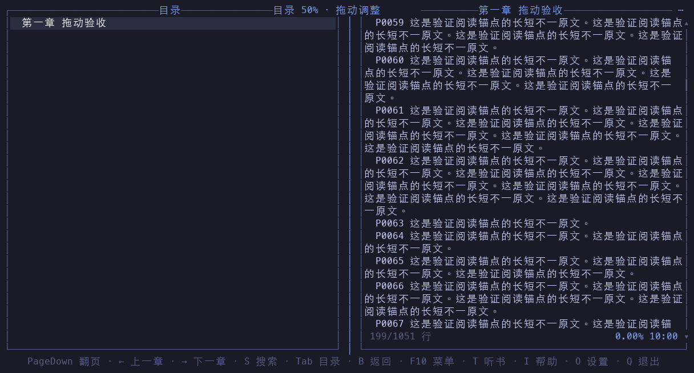
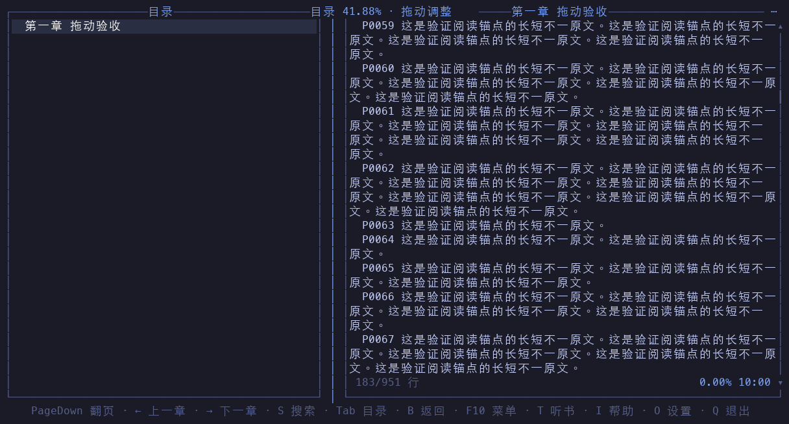
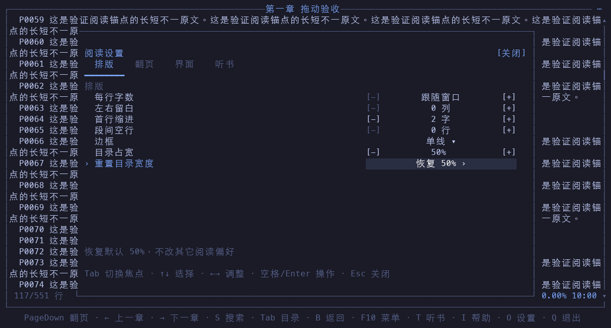
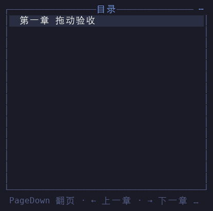
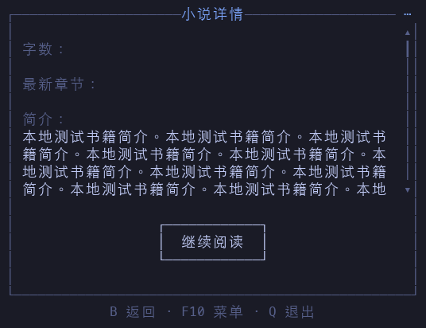

# 目录拖拽与描边阅读按钮验收

日期：2026-11-16。基线 `fc31c85`。方案：`openspec/changes/resizable-reader-panes/`。

## 行为与结构

- `TocWidth` 保存连续百分比（内部整数基点），配置为 `[reader].toc_width_percent`，默认 50%。按用户要求删除旧三档类型、选择器、别名和兼容读取，不做迁移。
- 阅读与全局设置共用数值控件，每次调整一个百分点；“重置目录宽度”只恢复宽度，不改其它偏好。保存沿用共用的有序防抖与卸载 flush。
- `PaneLayout` 集中计算三列拖动区、目录至少 18 列和正文至少 30 列；不足 51 列时目录单栏。拖动使用按下起点计算，捕获可覆盖条外区域；释放后不再调整。仅改变窗口高度、窗口宽度、切换视图和覆盖浮层均结束拖动。
- 分隔条独立于目录滚动条，hover 高亮；百分比提示放在阅读页浮层，避免被三列组件裁剪。
- 原文字节锚点及上一版布局由阅读页持有，跨预览、全屏正文、窄窗口隐藏与恢复保留。连续重排不重复取新行首，避免逐步漂移；不同书籍/章节/内容有独立身份。搜索定位和播放跟随保留原有优先级，原文和听书偏移不变。
- `OutlinedButton` 与退出确认共用描边、主题和稳定回调；详情阅读按钮仍固定底部居中，整框可点，加载禁用，原键盘动作保留。

## 验证

通过全功能 workspace lib/tests/examples、严格 Clippy、格式、严格 rustdoc、无默认和仅 TTS lib 测试、两种主程序构建、文档站构建、严格 OpenSpec 校验。

真实 PTY 使用隔离 HOME，不访问真实书站、不启动真实模型：

```sh
cargo build --locked --all-features --bin trn
uv run tests/pty/reader_panes.py
uv run tests/pty/book_detail.py
uv run tests/pty/settings_tabs.py
uv run tests/pty/settings_surfaces.py
```

新增回归包括：hover 不改配置；连续拖动往返保持混合长短段落位置；捕获后拖出并在目录区域释放不选章；释放后移动不改值；分别改变终端宽、高取消；40 列目录单栏与正文切换；预览隐藏后恢复不同宽度和反复 Tab 保持锚点；百分比加减、明确重置、退出和重启恢复。详情按钮测试点击上边框角进入缓存第二章，禁用和 hover 也保留。

运行 feature 构建时不要覆盖 PTY 正在使用的程序，可通过 `TRNOVEL_TEST_BINARY` 指向固定副本，`TRNOVEL_TEST_ARTIFACTS` 保存字符网格与颜色。

## Standards

复查发现 1 项 P2：只监听宽度会遗漏高度变化时的拖动取消。现监听完整终端尺寸，并加入高度单独变化的捕获回归。复查无遗留发现。

## Spec

复查发现 1 项 P2：组件局部锚点会在窄窗口或 Tab 重挂载时丢失。现由页面持有锚点并按书籍、章节和内容识别，混合段落实测保留同一位置。复查无遗留发现。

下图来自真实 PTY 字符和颜色网格导出，不是设计稿。










