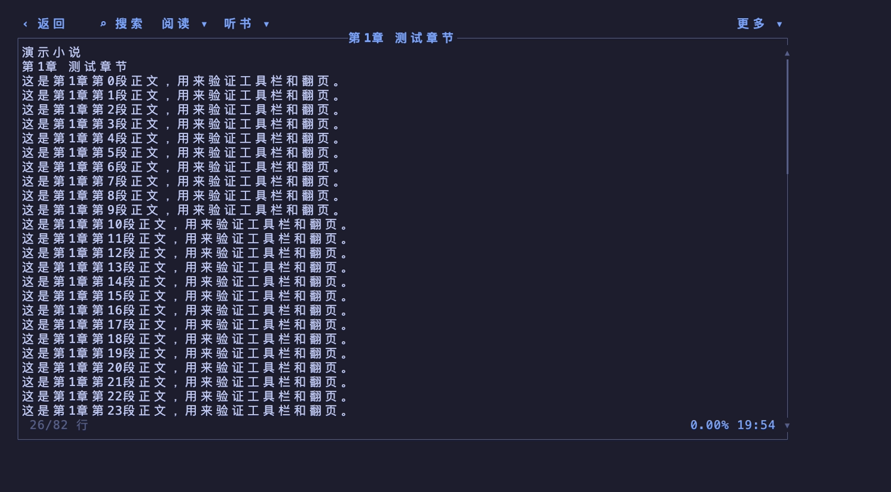
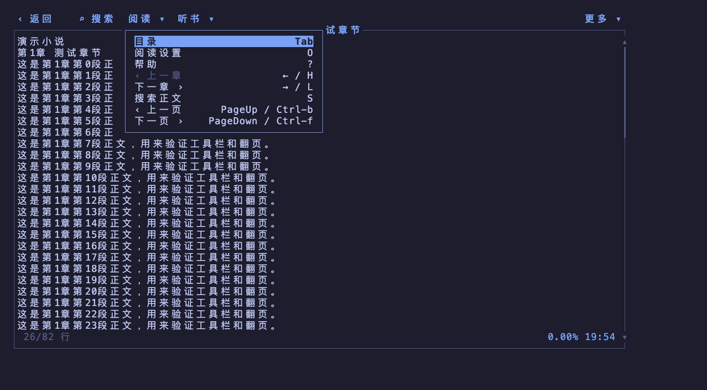
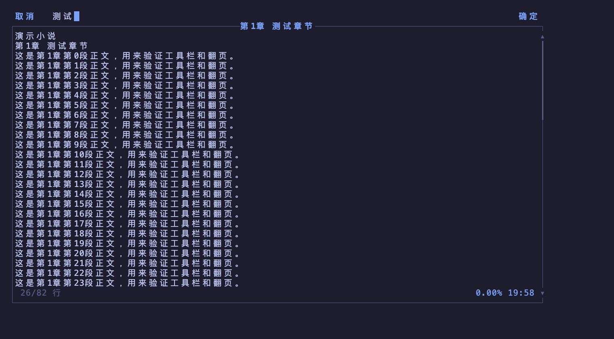
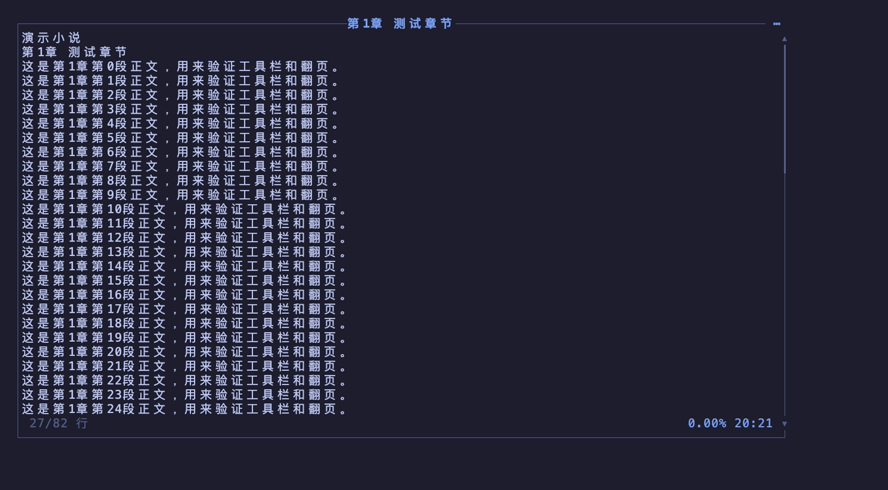
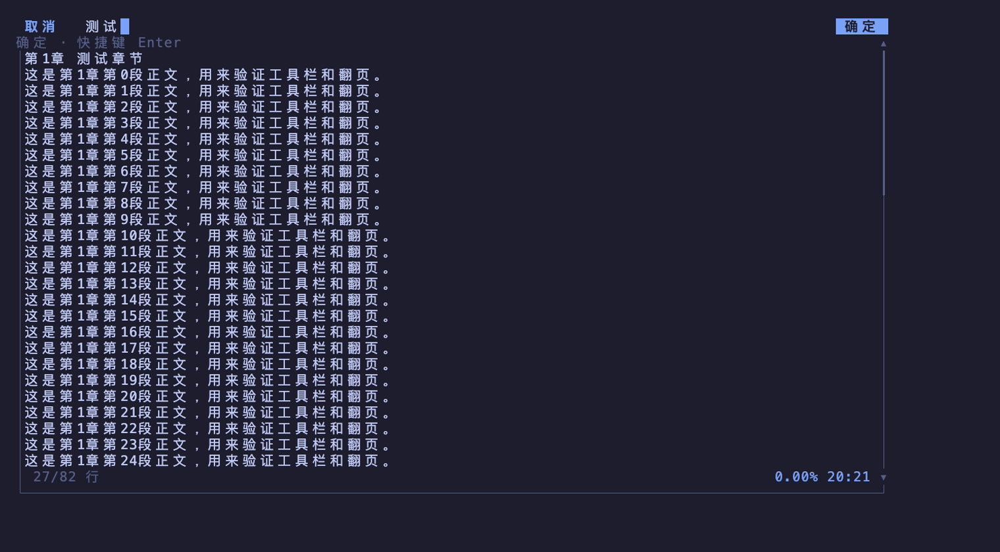
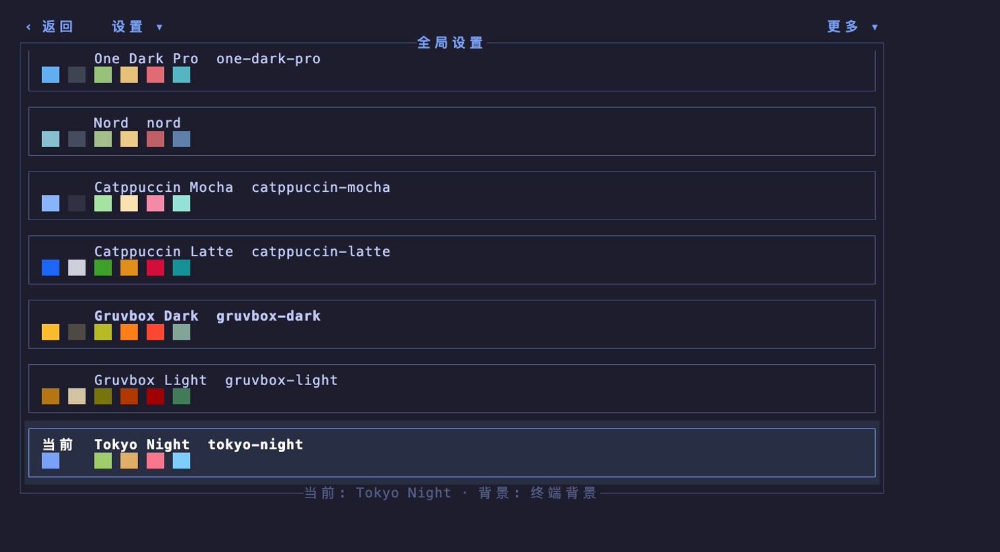

# 可见操作入口验收

网络小说、本地小说和阅读页共用一行顶栏：返回文字按钮、折叠搜索与分组菜单。阅读操作收进「阅读 / 听书 / 更多」，选书页提供本地、频道、书籍、书源等对应分组。浮动菜单覆盖内容而不挤占正文；菜单项右侧显示实际快捷键。点击搜索或按搜索快捷键，顶栏切换为输入框；输入与菜单互斥。搜索时左侧返回原位变成取消，右侧只显示确定；点击取消或 Esc 收起输入并留在当前路由。正文匹配切换收进阅读菜单，底部不常驻快捷键提示。

F10 打开菜单，左右切换分组、上下选择、Enter 执行、Esc 关闭。鼠标悬停选中、点击执行，菜单打开后悬停其他顶栏分组可以切换。外部点击只关闭菜单，不触发背景操作。不显示当前页面标题，返回文字按钮与搜索分组留出间距，「更多」靠行尾，悬停提示为临时浮层。

帮助、阅读设置和听书设置屏蔽背景导航。阅读页的快捷键提示取实际 keymap；测试将帮助键重绑为 `?`，检查按钮提示和弹窗关闭行为。正文翻页和设置面板显示的步长按实际正文视口计算。

## 重跑真实终端验收

```sh
cargo build --locked
python3 -m venv /tmp/trnovel-ui-venv
/tmp/trnovel-ui-venv/bin/pip install pyte
/tmp/trnovel-ui-venv/bin/python dev-notes/visible-actions/verify.py \
  target/debug/trnovel dev-notes/visible-actions/evidence
```

脚本去掉测试进程继承的 NO_COLOR，以验证真实选中高亮；创建临时 HOME 和小说文件，并启动 loopback HTTP 服务器提供模拟 v2 书源。它不读取真实用户配置，不使用真实书站，不启用模型准备或推理。听书设置只检查界面开关。`evidence/*.txt` 来自真实终端 buffer；PNG 用 VHS 回放 PTY 保存的真实带颜色终端 buffer（*.ansi），不重新绘制界面。

覆盖：本地路径与筛选、网络频道选择和分页末端、详情进入阅读、正文搜索提交/匹配切换/清除、设置关闭、帮助键重绑与悬停、弹窗下背景返回屏蔽、鼠标及 B/G 历史导航、40 列窗口换行。全特性工作区测试、Clippy、rustfmt、rustdoc 和无默认特性构建另行运行。








全局设置可关闭顶部栏，偏好在重启后保留。隐藏时正文多出一行，F10 临时打开首个菜单，右上角 `⋯` 打开更多菜单；Esc、外部点击或执行动作后恢复隐藏。搜索输入临时覆盖顶部，取消及提交后恢复隐藏。更多菜单可随时恢复常驻顶栏。旧配置默认显示顶栏。





全局设置菜单提供顶部栏、背景模式、重置和帮助入口，底部只显示当前主题与背景状态。重置确认明确恢复默认主题、终端背景及顶部栏显示。


