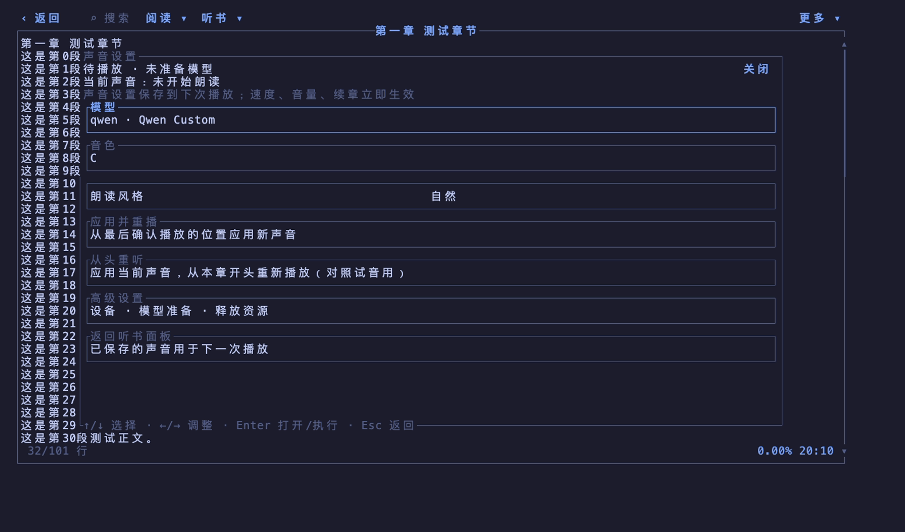
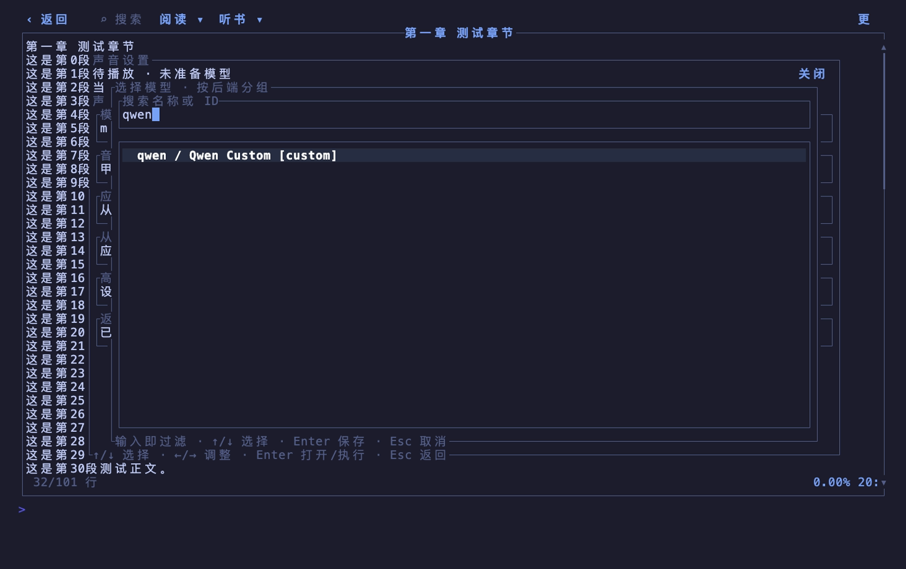

听书由独立安装的 [Talechime · 叙铃](https://github.com/yexiyue/talechime#installation) 处理。TRNovel 默认提供听书 UI，仅链接轻量协议库，通过 JSON Lines v7 与 worker 通信；两边应用版本无需相同。普通阅读无需安装 worker。标准包提供 Nano 与 Qwen / VoxCPM / OmniVoice；Apple Silicon 增加 Metal 和 MOSS Candle Metal，Windows/Linux 使用 CPU。CUDA 通过源码构建使用。

## 从源码构建

MOSS 的 GPU 实验档可增加 `moss-candle-cuda`，提供 `local-1.7b` 和
`realtime-1.7b` 模型。两者使用统一 Candle，旧 Nano 和音色格式保留。
当前优先试听 Realtime；Local 尚未达到主力速度要求。

```sh
cargo build --release --manifest-path ../talechime/Cargo.toml -p talechime --target-dir target --features qwen-cuda,voxcpm-cuda,omnivoice-cuda,moss-candle-cuda
talechime --backend moss --model realtime-1.7b --tts-device cuda voices design myvoice --name "我的音色" --description "温暖清晰的成年女性普通话"
talechime --backend moss --model realtime-1.7b --voice custom:myvoice --tts-device cuda book.txt
```

VoiceGenerator 只设计一次短参考，长文复用保存音色。导入参考为 1–10 秒 WAV，
需要 `--text` 记录对应文字。新模型及共用 codec 存在默认
`~/.talechime/moss/models/<id>/<revision>`；不同模型的音色和编码缓存隔离。
新模式暂只开放 GPU，CPU 继续用 Nano；CLI 可用 `--model nano --tts-device cpu` 切回。
Metal 构建入口为 `moss-candle-metal`。上游已验证 M4 Pro 24 GB 上的 Realtime 1.7B 初始化修复，Local 1.7B 仍可能 GPU OOM；本轮分发检查不代替模型试听。

在 TRNovel 仓库构建阅读器，Talechime 在它自己的仓库独立构建。使用同级检出时：

```sh
cargo build --locked -p trnovel --bins
cargo build --locked --manifest-path ../talechime/Cargo.toml -p talechime --features qwen,voxcpm,omnivoice
trnovel --tts-program ../talechime/target/debug/talechime
```

查找顺序为 `--tts-program <路径>`、`~/.trnovel/config.toml` 的 `[tts].program`、PATH 中的 `talechime`。明确路径无效直接报错；缺少程序会显示安装链接，不影响普通阅读，不自动安装或更新。数据搬迁见[迁移指南](/TRNovel/guides/migration/)。

## 不进入 TUI 的快速设置

`trnovel` 和 `trn` 都支持以下命令。查询目录和保存设置只进行协议握手，不下载或加载模型，也不播放。

```sh
# 查看阅读器已保存的听书设置，无需安装 worker
trn tts show
# 查询模型、音色 ID 和编译支持的设备
trn tts list
trn tts list --backend moss --model nano-candle
# 指定本地测试版 worker；相对路径会保存为绝对路径
trn tts setup --program ../talechime/target/release/talechime
# 一次配置待用声音
trn tts setup --backend moss --model nano-candle --voice Yuewen --device cpu
# 模型支持风格时设置；空字符串清除
trn tts setup --style "平静、自然"
trn tts setup --style ""
```

`setup` 保存前验证 worker 协议、模型、音色 ID、设备与风格能力；无效参数不会修改配置。仅指定 `--program` 时保留原声音偏好。切换模型默认采用新模型的默认音色并清除风格，不兼容设备回到 `auto`；显式指定不支持的设备或音色会报错。

设置保存到阅读器的 `[tts]` 与 `[tts.sound]`，下次播放使用。已运行的阅读器需要重启后读取 CLI 保存的偏好。`--tts-program` 仍可作临时启动覆盖；在 `tts setup` 中使用它也会保存路径。速度、音量和续章仍在听书面板即时调整。

## 听书面板与声音设置

阅读模式按 `T` 打开听书面板。查看目录只启动轻量协议连接，不下载、不加载模型，也不播放。需要支持协议 v7 的 Talechime；旧 worker 会提示升级，普通阅读仍可用。

听书面板提供暂停/继续、播放速度、音量、自动续章和声音设置入口。↑/↓ 或 j/k 移动焦点，←/→ 调整速度（0.5..2 倍）、音量（0..10）和续章开关，它们立即生效。Enter 执行当前操作，Esc 逐级返回。面板与阅读设置互斥，背景正文不会响应导航。

声音设置中的模型与音色使用可搜索列表：Enter 打开，输入文字即时过滤名称或 ID，↑/↓ 选择，Enter 确认保存，Esc 取消。模型按后端分组；切换后使用目标默认音色，风格清除，不兼容设备回到 Auto。只有支持风格的模型显示“朗读风格”。音色管理仍通过 Talechime CLI 完成。





模型、音色、风格与设备保存到 `~/.trnovel/config.toml` 的 `[tts.sound]`，用于下一次播放，浏览和保存不会打断当前朗读。面板分别显示当前声音和待用声音。**应用并重播**明确切换到新声音，从最后确认实际播放完成的原文边界继续；未播完片段可能重新朗读，暂停状态会保留。**从头重听**丢弃当前进度，从本章开头用当前声音立即开播，适合切换模型或音色后对照试音。

听书面板的**播放策略**选择章节的播放方式：流式播放边生成边播；**整章生成后播放**先完成整章合成再开始播放，期间没有生成停顿，适合合成速度快于实时的模型或提前备好一章的场景。策略在下一次开始朗读时生效。

整章生成后播放还带整章音频缓存：封闭计划从头播放、固定 seed 且关闭回读时，同一章以相同模型、设备、预置音色、风格与参数再次播放会直接从缓存重放；更换这些生成条件则重新生成。自定义克隆音色暂不缓存，避免同名参考资源更新后播放旧音频；断点续播使用一次性暂存。缓存在 `~/.talechime/cache/chapters`，按时间淘汰，默认上限 8 GiB。

高级设置包含合成设备、模型准备、取消准备和释放资源。准备只在停止时应用待用模型；播放中切换请使用“应用并重播”。释放资源会停播并关闭子进程。准备过程显示下载进度和错误；取消保留可续传的部分文件。

## 模型准备

按播放键 `P` 或在准备行按 Enter 才会加载模型，并下载缺少资源。下载可取消、续传；半文件保留，服务器忽略 Range 时重头下载。

MOSS 资源保存在 `$HOME/.talechime/moss/{tts,codec}`，固定版本共约 763 MB，下载后校验大小和 SHA-256。损坏文件会隔离，下次准备重新下载。支持原生流式播放，输出 48kHz 双声道 PCM；按自然段合并上下文，跳过装饰分隔行，裁剪块边界静音。高亮按实际播放片段推进。

`--model-dir` 覆盖包含各后端子目录的公共根目录。

### Qwen TTS（Candle）

可选 `qwen` feature 集成原生 Candle 推理，支持 0.6B/1.7B CustomVoice 与 1.7B Base；已有未声明模型的 Qwen 配置仍使用 0.6B，提供九种预置音色，默认福叔 `uncle_fu`。0.6B 资源约 2.50 GB，1.7B 每种变体约 4.52 GB，仅下载所选模型并校验到 `$HOME/.talechime/qwen/`。

```sh
# macOS：保留 MOSS，增加 Qwen 与 Metal GPU 支持
cargo build --release --manifest-path ../talechime/Cargo.toml -p talechime --target-dir target --features qwen,metal
# Windows/Linux NVIDIA：只编入 Qwen，编译时需要 CUDA Toolkit
cargo build --release --manifest-path ../talechime/Cargo.toml -p talechime --target-dir target --no-default-features --features qwen-cuda
talechime --backend qwen --voice uncle_fu book.txt
talechime --backend qwen voices list
```

TUI 按模型能力展示可用音色；Qwen Base 提供参考音频克隆，1.7B CustomVoice 提供朗读风格。阅读器保存新模型时只更新待用声音；不兼容设备重置为 auto。Qwen 支持 CPU、Candle CUDA（Windows/Linux）和 Metal（macOS）。Metal 与 CoreML 是不同执行路径，请按各后端报告的设备选择。

Candle 实现已纳入本地 `Talechime 仓库的 crates/qwen3-tts`，来源 revision 已记录。流式小块的解码边界、长文本覆盖和主观音质需要试听确认，不能以正常 EOS 代替音质验收。

### 其他模型

| 后端 | 模型选项 | 设备 / 输出 | 音色 |
| --- | --- | --- | --- |
| VoxCPM2 | `2b-q8_0` | CUDA / Metal / CPU；48kHz 原生流式 | 参考 WAV + 文字克隆，描述设计 |
| VoxCPM2（实验） | `2b-bf16` | CUDA；原始 BF16 网络 + F32 AudioVAE，48kHz 原生流式 | 独立音色和参考编码缓存 |
| OmniVoice | `0.6b` | CUDA / Metal / CPU；24kHz 语义分段 | 克隆，支持标签描述设计 |

编入 `voxcpm-cuda` 后，可在阅读器的 VoxCPM 后端“模型”行选择
“原始 BF16（实验）”；默认仍为 Q8，已有选择保留。实验模型约 4.96 GB，
保存在 `~/.talechime/voxcpm/models/2b-bf16/<revision>`，已有完整缓存直接校验复用。
数值对照、人工听感和长期稳定性仍有待验收项，设置面板会显示提示。
音色按模型隔离；要比较同一音色，可用 `--model 2b-bf16 voices import`
重新导入相同参考 WAV 和文字。实验档不开放 CPU 或 Metal。

```sh
cargo build --release --manifest-path ../talechime/Cargo.toml -p talechime --target-dir target --features qwen-cuda,voxcpm-cuda,omnivoice-cuda
talechime --backend qwen --model 1.7b-customvoice --tts-device cuda book.txt
talechime --backend qwen --model 1.7b-base voices design storyteller --name "沉稳男声" --description "沉稳、自然的中文男声"
```

VoxCPM2 和 OmniVoice 使用相同的 `voices list/import/remove/design` 入口，阅读器选择已保存音色。设计只生成一次短参考，长文复用克隆音色。模型、revision 和音色缓存相互隔离。OmniVoice tokenizer 附带 BOSON/Higgs/Llama 许可。

macOS 使用 `metal,voxcpm-metal,omnivoice-metal`。协议版本为 7，旧 worker 会明确提示版本不匹配。Windows RTX 5070 实测与待验收项目记录于仓库 `dev-notes/tts-model-tiers-acceptance.md`。

## 导入音色

```sh
talechime voices list
talechime voices import narrator --name "我的朗读音色" reference.wav
talechime --backend moss --voice custom:narrator book.txt
talechime voices remove narrator
```

参考音频使用 1..30 秒非静音 mono/stereo WAV，内部重采样和编码，保存到 `~/.talechime/moss/voices/`。播放只读取缓存，不重复编码。重复 ID 拒绝覆盖，删除仅限自定义音色。导入后重新连接听书程序以刷新 TUI 音色目录。首版通过 CLI 管理音色，TUI 只选择音色。

## 播放与恢复

在阅读模式按 `P` 播放/暂停，`+`/`-` 调音量。切章停止旧会话并过滤迟到事件；搜索高亮优先。暂停保留位置，停止保留模型，释放资源关闭程序。只有当前章节正常播放完成才能触发自动续章，最后一章结束后复位。

恢复点由听书程序保存在 `~/.talechime/checkpoints/`。正文 SHA-256、来源和 UTF-8 字节坐标必须匹配；正文变化、损坏数据或未知版本会提示错误，可用独立命令 `talechime --restart book.txt` 重置该文件的恢复点。崩溃后可能重复最近未完成片段，不自动开始播放。

听书配置仍是 `~/.talechime/config.json`，旧音量、速度、音色、自动播放字段保留。有可用 GPU 且编入 Qwen 时，新配置选择 1.7B-CustomVoice 和检测到的 CUDA/Metal；否则选择 CPU MOSS Nano。已退休后端不再自动迁移，需手工选择当前支持的模型。未编译的后端会明确报错，需要用户主动切换。Talechime 的配置只通过协议修改；阅读器另存待用声音偏好，界面显示保存成功后的快照。配置损坏或修订冲突时不会覆盖原文件，刷新后再主动修改。

## 独立文件朗读

```sh
talechime book.txt
talechime --restart book.txt
```

仅支持 UTF-8 文本文件。交互终端中空格暂停/继续，s 停止并退出，q/Esc/Ctrl+C 退出；非交互终端不启用原始模式，正文完成后退出。详细的协议、路径覆盖和退出码见仓库 [Talechime README](https://github.com/yexiyue/talechime)。

回退时阅读器与听书程序成对回退，保留配置、模型和检查点；阅读历史及阅读进度格式未改变。

## 播放高亮与缓冲

协议 v7 不再提供强制对齐或逐句高亮入口。阅读器仍按实际播放的片段高亮原文并跟随视口；生成完成不代表播放完成，只有当前会话正常播完才自动续章。

### 流式播放缓冲

播放前会积累约 3 秒音频，减少小块生成波动引起的停顿。队列耗尽时显示“缓冲中”，恢复目标逐次增大，最多约 10 秒；暂停期间仍可在内存预算内预取。短文本生成完后直接播放，不必攒满目标。播放倍率越高，需要的原始音频余量越多。

若模型长期生成得比播放慢，缓冲只能减少频繁停顿，不能保证无限连续播放。Qwen 可用 `NOVEL_TTS_DIAGNOSTICS=1` 在 worker stderr 查看每块生成耗时、音频长度和通道等待；阅读器底栏显示缓冲余量及耗尽次数。
